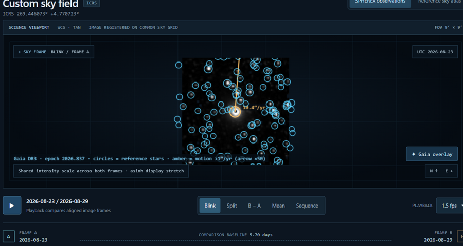

# 🌌 SPHEREx Motion Explorer

**Time-Domain Observational Astronomy Workbench for NASA's SPHEREx Archive**

[](http://44.239.210.28/)
[](https://www.python.org/)
[](https://fastapi.tiangolo.com/)
[](https://www.astropy.org/)
[](tests/)
[](LICENSE)

> 🚀 **Live Interactive Web App:** **[http://44.239.210.28/](http://44.239.210.28/)**  
> *Free, publicly accessible, and instant. No login, password, or local installation required — open directly in any browser to query live NASA/IPAC SPHEREx observations.*

An open-source scientific research workbench designed to query, register, and visualize time-domain celestial motion and infrared variability using public data from NASA's **SPHEREx** mission (*Spectro-Photometer for the History of the Universe, Epoch of Reionization and Ices Explorer*).

---

## 🎯 Core Philosophy: Real Archive Data Only

- **Zero Mock Data:** The workbench never generates, fabricates, or simulates celestial imagery, light curves, or observation timestamps.
- **Direct Live Ingestion:** Queries are executed live against official **NASA/IPAC IRSA SIA v2** and **TAP** endpoints.
- **Transparent Provenance:** Every displayed frame links directly to its source FITS URL at IRSA, carrying verified observation dates, detector bands, and instrumental bit-flags.

---

## 📸 Interface Preview


*Real SPHEREx QR3 exposure of Barnard's Star with proper-motion-propagated Gaia DR3 overlay (identifying the 10.4″/yr fast mover).*

---

## 📊 Presentation Deck

* **PDF Presentation:** [docs/QoreX_SpaceApps_Demo.pdf](docs/QoreX_SpaceApps_Demo.pdf)
* **PowerPoint Slides:** [docs/QoreX_SpaceApps_Demo.pptx](docs/QoreX_SpaceApps_Demo.pptx)

---

## 🚀 Key Features

| Capability | Description |
|---|---|
| **Blink Comparator** | Alternates between registered epochs at configurable speeds with synchronized asinh display stretch. |
| **Split View** | Side-by-side synchronized comparison of two observational epochs. |
| **B − A Difference** | Signed pixel-level residual visualization (Amber = Frame B brighter; Cyan = Frame A brighter) with scientific flag masking. |
| **Chronological Sequence** | Select 2 to 8 archive exposures for seamless temporal playback on a common brightness scale. |
| **Gaia DR3 Astrometric Overlay** | Real-time proper-motion propagation to the observation epoch with velocity vectors. |
| **On-the-Fly Spectrophotometry** | Parallel aperture flux extraction across up to 40 archive exposures (0.75–5.00 µm across all 6 detector arrays) with interactive SVG plot and CSV download. |
| **Local Spectral $\lambda$-Matching** | Accurately tracks per-pixel local wavelength via spectral WCS linear variable filter lookup. |
| **AllWISE Reference Atlas** | Embedded Aladin Lite v3 viewer backed by local IRSA AllWISE mid-infrared cutouts (no CDN or external tile server dependency required). |
| **Auditable Evidence Export** | One-click export of reproducible query URLs, high-resolution PNGs, and JSON evidence manifests with official dataset DOIs. |

---

## ⚡ Quick Start

### 🌐 Option 1: Live Web App (Instant Access / Zero Setup)

For judges, researchers, and users who want to try the workbench immediately without installing anything:
👉 **[http://44.239.210.28/](http://44.239.210.28/)**

* Hosted on AWS EC2 (always warm, no cold boot delays).
* Publicly accessible, no account or credentials needed.

---

### 💻 Option 2: Windows (One-Click Local Launch)

1. Make sure [Python 3.11 or 3.12](https://www.python.org/downloads/) is installed (ensure **"Add Python to PATH"** was checked during installation).
2. Double-click **`run_windows.bat`**.
3. The launcher will automatically:
   - Create a local virtual environment (`.venv`)
   - Install required dependencies
   - Open your browser to **`http://127.0.0.1:8000`**

### 🐧 Option 3: Linux / macOS

Run the shell script:
```bash
chmod +x run_unix.sh
./run_unix.sh
```

Or run manually step-by-step:
```bash
# 1. Create and activate a virtual environment
python3 -m venv .venv
source .venv/bin/activate

# 2. Install dependencies
pip install -r requirements.txt

# 3. Start the application
python -m uvicorn backend.app:app --host 127.0.0.1 --port 8000
```
Open **`http://127.0.0.1:8000`** in your browser.

### 🐳 Option 4: Docker Deployment

Deploy anywhere with Docker (e.g., local, AWS, GCP, Fly.io, Hugging Face Spaces):
```bash
docker build -t spherex-motion-explorer .
docker run -p 7860:7860 spherex-motion-explorer
```
Open **`http://localhost:7860`**.

---

## 📖 Walkthrough & User Guide

```text
[1. Select Target] ──▶ [2. Find Observations] ──▶ [3. Pick Frames A & B] ──▶ [4. Compare / Blink / Analyze]
```

1. **Target Selection:**
   - Choose a preset target from the dropdown:
     - **Barnard's Star:** Highest proper motion star known ($10.4″/\text{yr}$)
     - **$\varepsilon$ Indi B:** Nearby brown dwarf binary system
     - **WISE 0855−0714:** Cold sub-stellar brown dwarf ($8.1″/\text{yr}$)
     - **RW Aurigae:** Classical T Tauri star with dramatic photometric occultations
     - **R Draconis:** Long-period Mira-type variable star
   - Or enter custom **RA** ($0^\circ–360^\circ$), **Dec** ($-90^\circ–+90^\circ$), and **Field of View** ($1′–18′$).
2. **Retrieve Real SPHEREx Archive Records:**
   - Select release: **QR3** (Quick Release 3) or **QR2**.
   - Select survey: **All-sky survey (Wide)** or **Deep fields**.
   - Click **Find observations**.
3. **Select Comparison Epochs:**
   - Click **Use widest baseline** to automatically pick two maximally separated epochs with matching detector configurations, or manually assign **A** and **B** buttons on any exposure rows.
4. **Inspect & Compare:**
   - Toggle view modes: **Blink** (`Spacebar` to toggle), **Split**, or **B − A** (difference).
   - Click **✦ Gaia overlay** to inspect Gaia DR3 reference stars and proper motion arrows at the observation epoch.
   - Click **Extract spectrum** to extract spectrophotometry from multiple exposures across all available SPHEREx detectors.
   - Use **↓ Evidence JSON** to download a verifiable audit manifest.

---

## 🛠️ Offline Verification & Test Suite

The repository contains 29 comprehensive offline unit tests verifying data validation, WCS re-projection, photometric flag bitmasking, and UI contracts without relying on live external networks:

```bash
# Run all unit tests
pytest -v
```

All 29 tests run in ~3 seconds.

---

## 📁 Repository Structure

```text
spherex-motion-explorer/
├── backend/                  # FastAPI scientific backend
│   ├── app.py                # REST endpoints, validation & static file routing
│   ├── archive.py            # NASA/IPAC IRSA SIA v2 archive adapter & retries
│   ├── atlas.py              # IRSA AllWISE mid-infrared reference cutouts
│   ├── catalog.py            # Gaia DR3 TAP query & proper-motion propagation
│   ├── flags.py              # SPHEREx bitmask flag filtering (SSDC-DP-017)
│   ├── science.py            # Celestial WCS reprojection & robust contrast stretch
│   └── spectrum.py           # Multi-exposure aperture spectrophotometry engine
├── frontend/                 # Client UI (zero heavy frameworks)
│   ├── index.html            # Dark-theme observatory workbench interface
│   ├── style.css             # Scientific UI styling & responsive layout
│   ├── app.js                # State management, transport playback, canvas overlay
│   └── vendor/               # Vendored Aladin Lite v3 (no CDN dependency)
├── docs/                     # Interface screenshots and references
├── tests/                    # 29 offline pytest unit tests
├── Dockerfile                # Production container deployment image
├── requirements.txt          # Minimal Python dependencies
├── run_windows.bat           # One-click Windows runner
├── run_unix.sh               # One-click Unix/macOS runner
├── LICENSE                   # MIT License
└── README.md
```

---

## 🌐 Network Resilience & IRSA SIA Status

The workbench communicates directly with Caltech/IPAC IRSA servers:
- **SPHEREx SIA v2:** `https://irsa.ipac.caltech.edu/SIA`
- **IRSA TAP Service:** `https://irsa.ipac.caltech.edu/TAP/sync`
- **IRSA Image Backend:** `https://irsa.ipac.caltech.edu/ibe`

> **Note on Archive Availability:**
> Under heavy server load, IRSA's SIA service for SPHEREx can experience temporary query stalls (flapping). The backend includes automatic progressive retries (up to 4 attempts with exponential backoff and timeouts extending to 180s) plus reduced initial batch caps.
> 
> If you encounter an `IRSA SIA service is unreachable: ReadTimeout`:
> 1. Wait a moment and click **Find observations** again.
> 2. Switch between **QR3** and **QR2** (earlier releases often have cached coverage).
> 3. Provide a tighter **Start / End UTC** filter to narrow the search volume.

---

## 📜 Scientific Caveats & Responsible Use

1. **Exploratory Tool:** This workbench is designed for scientific visualization, citizen-science vetting, and temporal comparison. It is not an automated object-detection pipeline or transient discovery certification service.
2. **Linear Variable Filter Geometry:** SPHEREx employs a Linear Variable Filter (LVF); adjacent pixels on the same detector record different wavelengths. The workbench reports local $\lambda$ at the target coordinates, but residual differences between frames with different local wavelengths represent spectral variance, not intrinsic stellar flux variability.
3. **Photometric Calibration:** Difference displays are reprojected visually with percentile clipping; they do not perform PSF-matched deconvolution or calibrated differential photometry.

---

## 📑 Citation & Datasets

- **SPHEREx Data:** Courtesy of NASA/JPL-Caltech/IPAC.
- **QR3 DOI:** [10.26131/IRSA662](https://doi.org/10.26131/IRSA662)
- **QR2 DOI:** [10.26131/IRSA652](https://doi.org/10.26131/IRSA652)
- **Gaia DR3:** European Space Agency (ESA) Gaia mission & IRSA TAP.
- **Reference Atlas:** NASA/IPAC Infrared Science Archive AllWISE coadded atlas & CDS Aladin Lite v3.

---

## 📄 License

This project is open-source under the [MIT License](LICENSE).
See [THIRD_PARTY.md](THIRD_PARTY.md) for third-party astronomy component notices.
